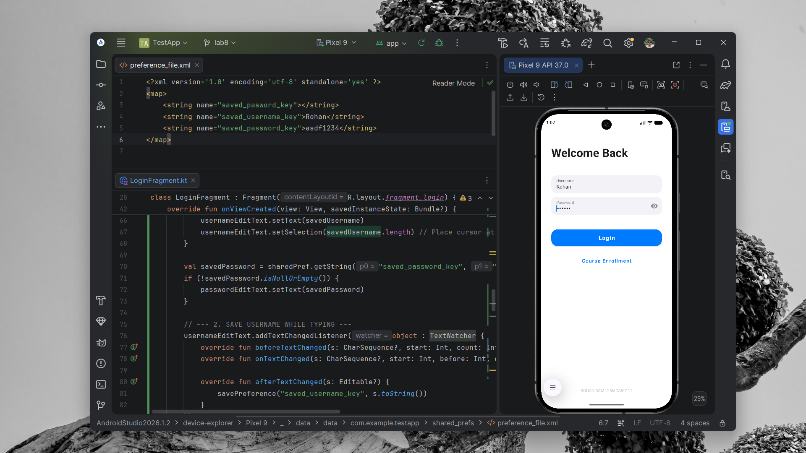
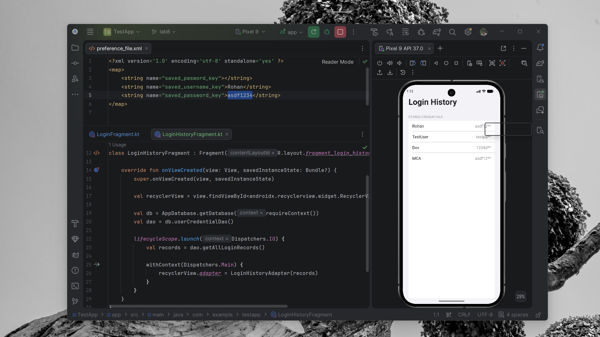

# TestApp - Authentication, Persistence & iOS-Themed UI

A modern Android application showcasing robust data persistence using **SharedPreferences** and **Room Database**, alongside custom Android UI components including a polished iOS-themed Login History table.

---

## 🔐 Authentication & Data Persistence

### 1. Live State Saving with SharedPreferences
The login screen implements real-time data caching. As the user types their credentials, the data is automatically saved using `SharedPreferences` via a `TextWatcher`. This ensures that if the app is closed, the inputs are restored upon reopening.

```kotlin
// Saving data asynchronously while typing
private fun savePreference(key: String, value: String) {
    val sharedPref = requireActivity().getSharedPreferences("preference_file", Context.MODE_PRIVATE)
    sharedPref.edit().putString(key, value).apply() 
}
```

### 2. Room Database Migration & Tracking
Upon a successful login, the cached credentials from `SharedPreferences` are verified and migrated into a robust local SQLite database using **Room**. Each successful login creates a new `LoginRecord` containing the username, password, and a timestamp.

```kotlin
// Asynchronous database insertion on Login
lifecycleScope.launch(Dispatchers.IO) {
    val db = AppDatabase.getDatabase(requireContext())
    val dao = db.userCredentialDao()
    
    // Store historical login record
    dao.insertLoginRecord(LoginRecord(username = prefUsername, password = prefPassword))
}
```

### 3. iOS-Themed Login History UI
The application features a "Login History" screen that displays a complete table of all previously logged-in users. It reads the historical data from the Room Database and presents it in a minimal, iOS-styled `RecyclerView` card layout.

For privacy and security, passwords are masked before they are rendered on the screen (the final two characters are replaced with asterisks `**`):

```kotlin
// Password masking logic inside the RecyclerView Adapter
val maskedPassword = if (record.password.length > 2) {
    record.password.dropLast(2) + "**"
} else if (record.password.isNotEmpty()) {
    "*".repeat(record.password.length)
} else {
    "No Password"
}
```

---

## 📸 Results

### Login Screen


### Login History


---
*Developed as part of an Advanced Android Mobile Application Architecture & UI/UX Design Project.*