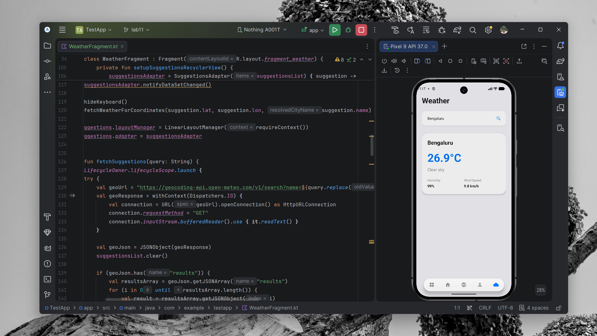

# Weather Integration App

A modern Android application feature integrating real-time weather forecasts and city search auto-complete using the free **Open-Meteo Geocoding & Weather APIs**.

---

## ☀️ Features & Implementation

### 1. Real-Time Debounced City Auto-Complete Suggestions
The application features a search box that fetches real-time city suggestions as the user types. To optimize network usage and avoid spamming the geocoding endpoint on every keystroke, a **300ms Coroutine debounce delay** is implemented using `lifecycleScope`.

```kotlin
// Coroutine debouncing for city search suggestions
etCitySearch.addTextChangedListener(object : TextWatcher {
    override fun beforeTextChanged(s: CharSequence?, start: Int, count: Int, after: Int) {}
    override fun onTextChanged(s: CharSequence?, start: Int, before: Int, count: Int) {}
    override fun afterTextChanged(s: Editable?) {
        if (isSelectingSuggestion) return
        
        val query = s?.toString()?.trim() ?: ""
        searchJob?.cancel()
        if (query.length < 2) {
            suggestionsCard.visibility = View.GONE
            return
        }
        
        searchJob = viewLifecycleOwner.lifecycleScope.launch {
            delay(300) // 300ms debounce
            fetchSuggestions(query)
        }
    }
})
```

---

### 2. Fetching & Displaying Weather Data via Open-Meteo API
When a user selects a city from the suggestion dropdown or submits a search, the app uses the city's geographical coordinates (`latitude` and `longitude`) to fetch current weather details—including temperature, weather conditions, humidity, and wind speed—via `HttpURLConnection` running asynchronously on `Dispatchers.IO`.

```kotlin
// Fetching weather data for selected coordinates
private fun fetchWeatherForCoordinates(
    lat: Double,
    lon: Double,
    resolvedCityName: String,
    showLoader: Boolean = true
) {
    if (showLoader) {
        progressBar.visibility = View.VISIBLE
        weatherResultCard.visibility = View.GONE
        weatherResultCard.alpha = 0f
    }
    
    viewLifecycleOwner.lifecycleScope.launch {
        try {
            val weatherUrl = "https://api.open-meteo.com/v1/forecast?latitude=$lat&longitude=$lon&current_weather=true&hourly=relative_humidity_2m"
            val weatherResponse = withContext(Dispatchers.IO) {
                val connection = URL(weatherUrl).openConnection() as HttpURLConnection
                connection.requestMethod = "GET"
                connection.inputStream.bufferedReader().use { it.readText() }
            }

            val weatherJson = JSONObject(weatherResponse)
            val current = weatherJson.getJSONObject("current_weather")
            val temp = current.getDouble("temperature")
            val windSpeed = current.getDouble("windspeed")
            val weatherCode = current.getInt("weathercode")
            
            val hourly = weatherJson.getJSONObject("hourly")
            val humidityArray = hourly.getJSONArray("relative_humidity_2m")
            val humidity = if (humidityArray.length() > 0) humidityArray.getInt(0) else 0

            val weatherDesc = interpretWeatherCode(weatherCode)

            // Update UI elements
            tvCityName.text = resolvedCityName
            tvTemperature.text = "${temp}°C"
            tvWeatherDesc.text = weatherDesc
            tvHumidity.text = "$humidity%"
            tvWindSpeed.text = "$windSpeed km/h"

            progressBar.visibility = View.GONE
            weatherResultCard.visibility = View.VISIBLE
            weatherResultCard.animate().alpha(1f).setDuration(500).start()
        } catch (e: Exception) {
            e.printStackTrace()
            showError("Failed to load weather data")
        }
    }
}
```

---

## 📸 Output Screenshot



---
*Developed as part of Weather API & Auto-Complete Integration Project.*
