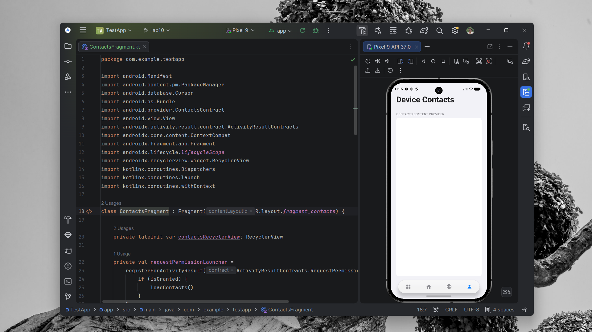

# TestApp - Google Maps "Locate Me" Integration

A modern Android application demonstrating real-time geolocation retrieval using Google Play Services **Fused Location Provider** and embedding interactive **Google Maps** directly inside the app via a custom HTML WebView iframe wrapper.

---

## 🗺️ Features & Implementation

### 1. Fused Location Provider & Runtime Permissions
The app requests runtime location permissions (`ACCESS_FINE_LOCATION` and `ACCESS_COARSE_LOCATION`) and uses `FusedLocationProviderClient` to fetch the device's current GPS coordinates asynchronously.

```kotlin
// Checking permissions and fetching current location
private fun checkPermissionAndFetchLocation() {
    if (ContextCompat.checkSelfPermission(
            requireContext(),
            Manifest.permission.ACCESS_FINE_LOCATION
        ) == PackageManager.PERMISSION_GRANTED ||
        ContextCompat.checkSelfPermission(
            requireContext(),
            Manifest.permission.ACCESS_COARSE_LOCATION
        ) == PackageManager.PERMISSION_GRANTED
    ) {
        fetchLocationAndLoadMap()
    } else {
        requestPermissionLauncher.launch(
            arrayOf(
                Manifest.permission.ACCESS_FINE_LOCATION,
                Manifest.permission.ACCESS_COARSE_LOCATION
            )
        )
    }
}

private fun fetchLocationAndLoadMap() {
    try {
        fusedLocationClient.lastLocation.addOnSuccessListener { location ->
            if (location != null) {
                loadMap(location.latitude, location.longitude)
            } else {
                loadMap(37.7749, -122.4194) // Fallback default location
            }
        }
    } catch (e: SecurityException) {
        loadMap(37.7749, -122.4194)
    }
}
```

### 2. Embedded Google Maps via WebView Iframe
To render Google Maps seamlessly inside the application without API key billing restrictions, the fetched latitude and longitude coordinates are injected into a responsive HTML `<iframe>` wrapper and loaded into the `WebView`.

```kotlin
// Loading embedded Google Maps inside WebView
private fun loadMap(lat: Double, lng: Double) {
    val html = """
        <!DOCTYPE html>
        <html>
        <head>
            <meta name="viewport" content="width=device-width, initial-scale=1.0">
            <style>
                html, body, iframe { width: 100%; height: 100%; margin: 0; padding: 0; border: none; }
            </style>
        </head>
        <body>
            <iframe src="https://maps.google.com/maps?q=$lat,$lng&z=15&output=embed" width="100%" height="100%" style="border:0;" allowfullscreen="" loading="lazy"></iframe>
        </body>
        </html>
    """.trimIndent()
    mapWebView.loadDataWithBaseURL(null, html, "text/html", "UTF-8", null)
}
```

---

## 📸 Output Screenshot



---
*Developed as part of Advanced Android Mobile Application Architecture & Google Maps Location Integration Project.*
